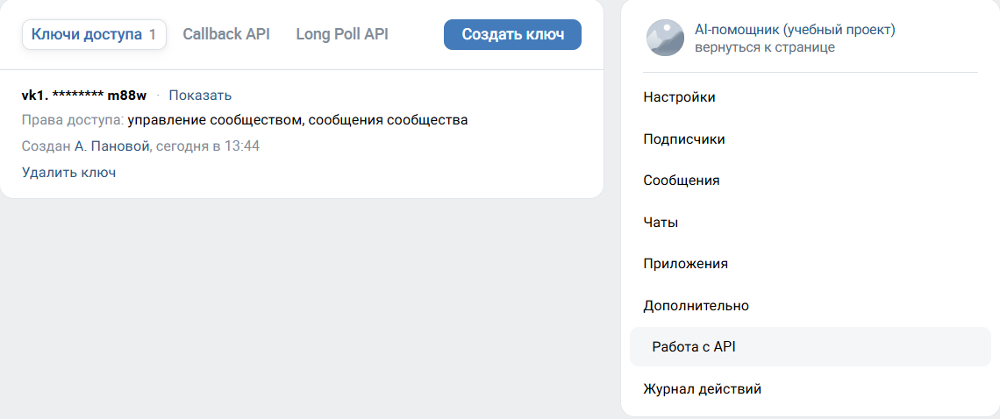
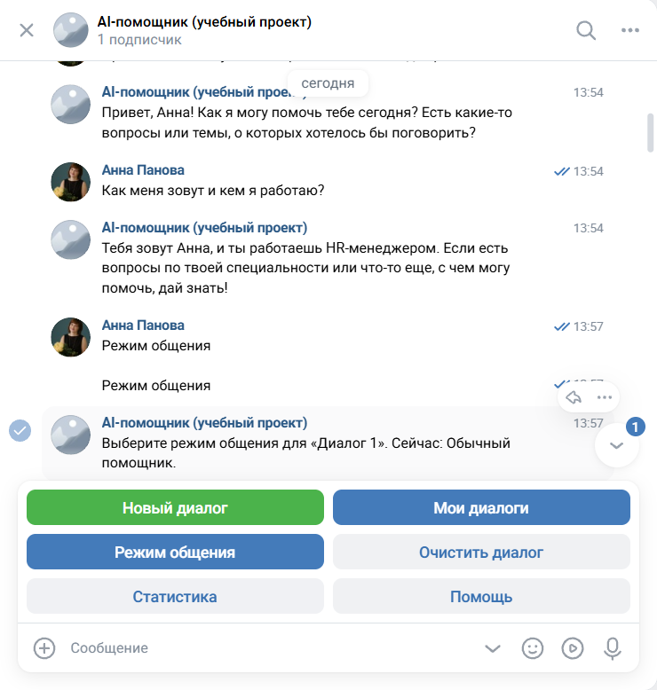
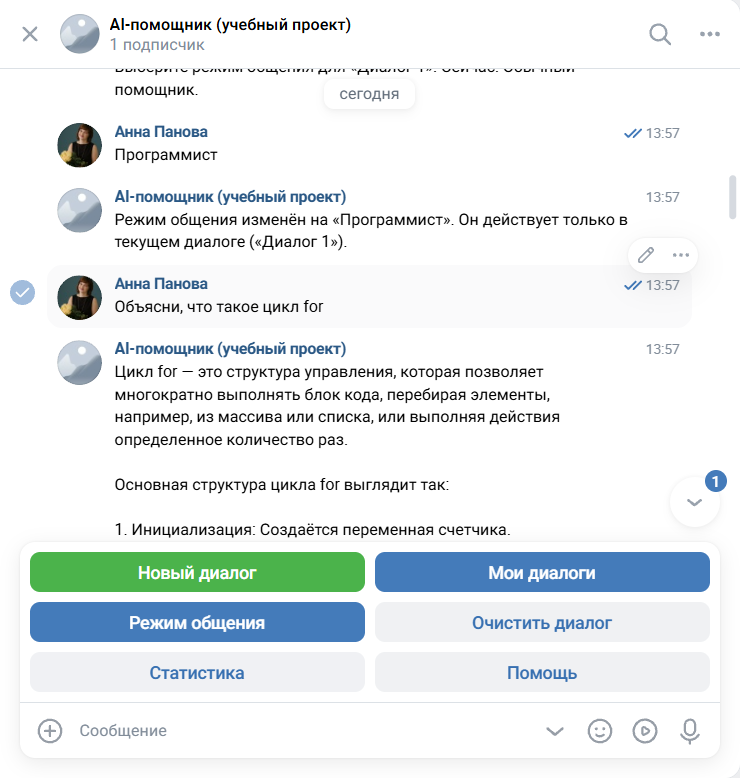
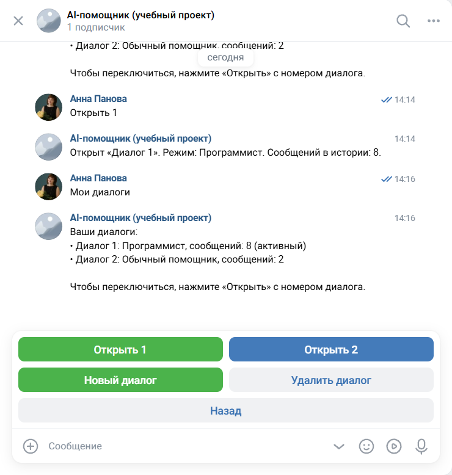

# AI-бот ВКонтакте: LLM, контекст и память диалогов

Домашнее задание к уроку 9 (программа «HR-архитектор и Вайб-кодер»), вариант 1: рабочий AI-бот ВКонтакте с краткосрочной и долгосрочной памятью, несколькими диалогами и режимами общения.

## Что умеет бот

- Отвечает на вопросы с помощью языковой модели и помнит контекст диалога.
- Ведёт несколько независимых диалогов, у каждого своя история и свой режим общения.
- Режимы общения: обычный помощник, программист, преподаватель, бизнес-консультант, дружелюбный собеседник. Режим меняет системный промпт и действует только в текущем диалоге.
- Хранит диалоги каждого пользователя в отдельном JSON-файле (папка `users/`), поэтому история не теряется при перезапуске.
- Показывает статистику: число диалогов, сообщений, запросов к модели и потраченных токенов.
- Меню на кнопках: новый диалог, мои диалоги, режим общения, очистить диалог, удалить диалог, статистика, помощь.
- Отвечает только пользователям из списка `ALLOWED_USER_IDS` (если он задан), чтобы посторонние не расходовали токены.

## Как это работает

```
Пользователь ВКонтакте -> VKBottle (Long Poll) -> controller (команды, диалоги, режимы)
                                                        |                  |
                                                        v                  v
                                             storage (JSON-файлы)   ai_service -> модель (OpenAI API)
```

- **Интерфейс:** сообщество ВКонтакте, бот получает сообщения через Long Poll API (подходит для локального запуска без сервера).
- **Контекст:** модель сама не помнит предыдущие сообщения, поэтому с каждым вопросом ей передаются системный промпт режима, последние 20 сообщений активного диалога и новый вопрос.
- **Краткосрочная память:** контекст диалога, который передаётся модели с каждым запросом.
- **Долгосрочная память:** история диалогов, режимы и статистика в файле `users/<ID пользователя>.json`. В каждом диалоге хранится не больше 100 последних сообщений, старые удаляются автоматически. Файл записывается через временный файл, поэтому не повреждается при сбое.
- **Роли сообщений:** `system` задаёт режим (роль и стиль), `user` и `assistant` хранят историю.
- **Markdown:** ВКонтакте не отображает Markdown, поэтому системный промпт просит писать обычным текстом, а ответ модели дополнительно очищается от звёздочек и решёток.

## Структура проекта

```
vk_bot/
├── main.py          # запуск бота и настройка журнала
├── bot.py           # подключение к ВКонтакте (VKBottle, Long Poll)
├── controller.py    # логика: команды, диалоги, режимы, общение с моделью
├── ai_service.py    # запросы к модели, подсчёт токенов
├── modes.py         # режимы общения (системные промпты)
├── models.py        # модели данных: сообщение, диалог, пользователь
├── storage.py       # хранение в JSON (долгосрочная память)
├── keyboards.py     # кнопки и меню
├── utils.py         # очистка Markdown, деление длинных сообщений
├── config.py        # настройки из .env
├── check_vk.py      # диагностика токена сообщества
├── requirements.txt
├── .env.example
└── screenshots/
```

## Установка и запуск

1. Создать сообщество ВКонтакте и включить сообщения сообщества и возможности ботов (Управление -> Сообщения).
2. Включить Long Poll API и тип события «Входящее сообщение» (Управление -> Работа с API -> Long Poll API).
3. Создать ключ доступа сообщества с правами **«управление сообществом»** и **«сообщения сообщества»** (Работа с API -> Ключи доступа). Без права «управление сообществом» бот не сможет подключиться к Long Poll.
4. Создать виртуальное окружение и установить библиотеки (Windows PowerShell):

```
python -m venv .venv
.\.venv\Scripts\Activate.ps1
pip install -r requirements.txt
```

5. Скопировать `.env.example` в `.env` и вписать токен сообщества и ключ модели:

```
Copy-Item .env.example .env
```

6. Запустить бота:

```
python main.py
```

7. Написать боту «мой id», чтобы узнать свой ID, и при желании записать его в `ALLOWED_USER_IDS` в `.env` (после этого бот будет отвечать только вам). Перезапустить бота.

## Настройки (файл .env)

- `VK_TOKEN` - ключ доступа сообщества ВКонтакте
- `AI_API_KEY` - ключ API модели
- `AI_BASE_URL` - адрес API (по умолчанию `https://api.openai.com/v1`)
- `AI_MODEL` - модель (по умолчанию `gpt-4o-mini`)
- `MAX_MESSAGE_LENGTH` - максимальная длина сообщения (по умолчанию 4000)
- `MAX_HISTORY_MESSAGES` - сколько сообщений хранить в диалоге (по умолчанию 100)
- `CONTEXT_MESSAGES` - сколько последних сообщений передавать модели (по умолчанию 20)
- `ALLOWED_USER_IDS` - ID допущенных пользователей через запятую (пусто - доступ у всех)
- `LOG_LEVEL` - уровень журнала

Токены и ключи хранятся только в `.env`, файл исключён из репозитория через `.gitignore` вместе с папкой `users/` (личные диалоги) и журналом `bot.log`.

## Выбор модели и расход токенов

Использована модель **gpt-4o-mini** через API OpenAI: недорогая и быстрая, хорошо отвечает на русском языке и поддерживает формат диалога с ролями `system`, `user` и `assistant`, что нужно для памяти и режимов общения. Ключ OpenAI был доступен сразу, поэтому ProxyAPI в проекте не использовался.

Код написан на библиотеке `openai`, совместимой с ProxyAPI, поэтому переход на ProxyAPI (например, на Gemini) требует только изменить настройки в `.env`: `AI_BASE_URL=https://api.proxyapi.ru/v1`, `AI_MODEL=google/gemini-2.5-flash` (пример из документации ProxyAPI, наличие модели нужно проверять в каталоге) и ключ ProxyAPI в `AI_API_KEY`.

Расход токенов в ходе проверки (по статистике бота): 5 запросов - 1695 токенов, в среднем около 340 на запрос. Например, первый запрос диалога потратил 166 токенов (вход 139, выход 27), а второй - 223 токена, потому что вместе с вопросом модели уходит история диалога (вход вырос до 184). Чем длиннее диалог, тем больше токенов тратит каждый следующий запрос, поэтому в контекст передаются только последние 20 сообщений. Расход каждого запроса пишется в журнал, суммарный доступен по кнопке «Статистика».

## Режим для демонстрации

На скриншотах показан режим **«Программист»**: бот объясняет технические темы по шагам, с короткими примерами. Режим выбирается кнопкой «Режим общения» и действует только в текущем диалоге: в другом диалоге остаётся свой режим и своя память.

## Диагностика

Если бот не запускается, `python check_vk.py` проверяет токен сообщества: права, сообщество, настройки Long Poll и доступность сервера Long Poll. Сам токен скрипт не выводит. Эта проверка понадобилась, потому что в текущей версии VKBottle при ошибке в фоновой задаче собственная ошибка логирования скрывает исходную причину сбоя.

## Скриншоты

Настройки сообщества: ключ доступа с правами «управление сообществом» и «сообщения сообщества» (токен скрыт):



Главное меню и память внутри диалога (бот помнит имя и профессию):



Смена режима общения на «Программист» и ответ в этом режиме:



Список диалогов и переключение между ними:



## Ограничения

- Бот работает, пока запущен на компьютере (`python main.py`).
- Работает только в личных сообщениях сообщества, сообщения из бесед игнорируются.
- Хранилище - JSON-файлы: подходит для демонстрации и небольшого числа пользователей. Для большой нагрузки стоит использовать базу данных.
- Ответы формулирует языковая модель и она может ошибаться.
- Если в ответ попало Markdown-форматирование, бот убирает самые частые элементы (звёздочки, решётки, обратные кавычки), но не все.